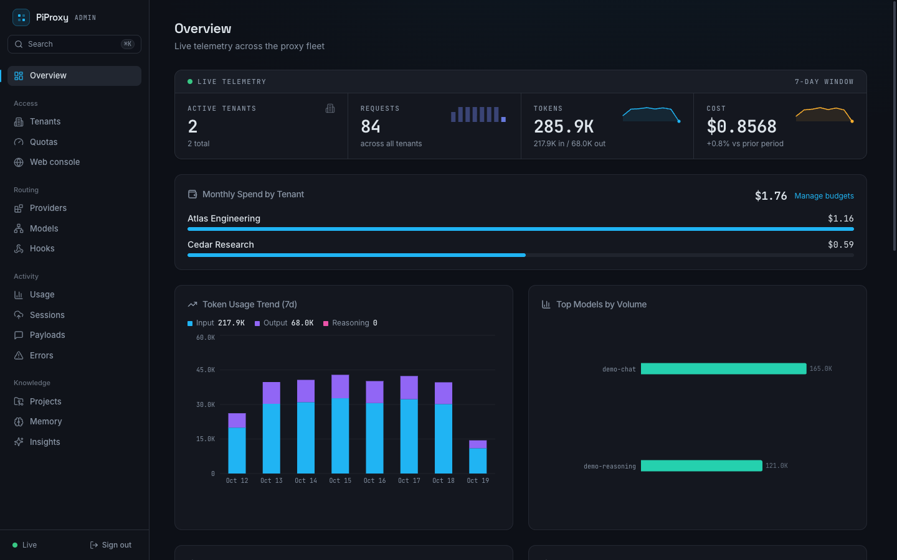
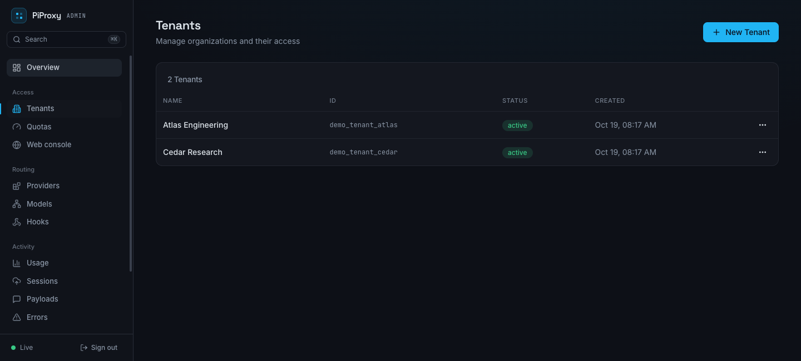

# Yapp — Yet Another Pi Proxy

A self-hosted gateway for team access to AI providers. Give each user a proxy API key, keep upstream credentials on the server, and manage tenants, spending limits, and usage from a web dashboard.

Yapp includes a Go data plane, an admin API, a React dashboard, and a [Pi coding-agent extension](extensions/corp-proxy.ts). PostgreSQL stores configuration and usage; Redis coordinates quotas and key revocation.

- **Central credentials:** encrypted provider credentials and scoped, revocable user keys.
- **Cost visibility:** usage reports by tenant, user, provider, and model, with spend budgets.
- **Provider APIs:** OpenAI and Anthropic request formats, plus additional provider adapters.
- **Optional session capture:** inspect coding-agent conversations with configurable retention. The quickstart disables capture.

## A look inside





## Try it locally

You need Docker with Compose v2 and `rsync`. From a checkout of this repository:

```sh
./examples/quickstart/build.sh
docker compose -f examples/quickstart/compose.yml up -d --wait
curl --fail http://localhost:18080/readyz
```

`make docker-up` is a shortcut for building and starting this same example.

Open **http://localhost:13333** and sign in with `local-demo-admin-key`.

The quickstart includes PostgreSQL, Redis, a local mock provider, and demo credentials. Services are available on localhost. For deployment with your own credentials and providers, follow the [self-hosting guide](docs/self-hosting.md).

To explore the dashboard with sample tenants and usage:

```sh
docker compose -f examples/quickstart/compose.yml exec -T postgres \
  psql -U proxy -d proxy -v ON_ERROR_STOP=1 < examples/quickstart/demo.sql
```

## Send your first request

No upstream account is needed for the local demo. Create a tenant, user, and proxy key in the dashboard, then export that key as `PIPROXY_KEY` and call the bundled mock provider:

```sh
curl http://localhost:18080/openai/v1/chat/completions \
  -H "Authorization: Bearer $PIPROXY_KEY" \
  -H 'Content-Type: application/json' \
  -d '{"model":"demo-chat","messages":[{"role":"user","content":"Hello!"}]}'
```

The mock provider returns a fixed greeting. `PIPROXY_KEY` is the user key issued by Yapp; the upstream credential stays on the server.

To exercise readiness, auth rejection, tenant/user/key creation, model discovery, and the proxied mock completion automatically (requires Python 3):

```sh
python3 examples/quickstart/smoke-test.py
```

For a real model, follow [Getting started](docs/getting-started.md) to add your provider credential and replace `demo-chat` with a model available to your account.

## Documentation

- [Getting started](docs/getting-started.md): local setup, provider credentials, users, keys, and troubleshooting.
- [Self-hosting](docs/self-hosting.md): secrets, networking, storage, migrations, and upgrades.
- [Contributing](CONTRIBUTING.md).

## Development

The backend requires the Go version declared in [go.mod](go.mod). The dashboard uses pnpm and the checked-in lockfile.

```sh
make build
make test
cd ui
pnpm install --frozen-lockfile
pnpm build
```

`make test` runs Go tests with race detection. The backend depends on the local `third_party/duffel` module; retain that directory when building from a source archive.
